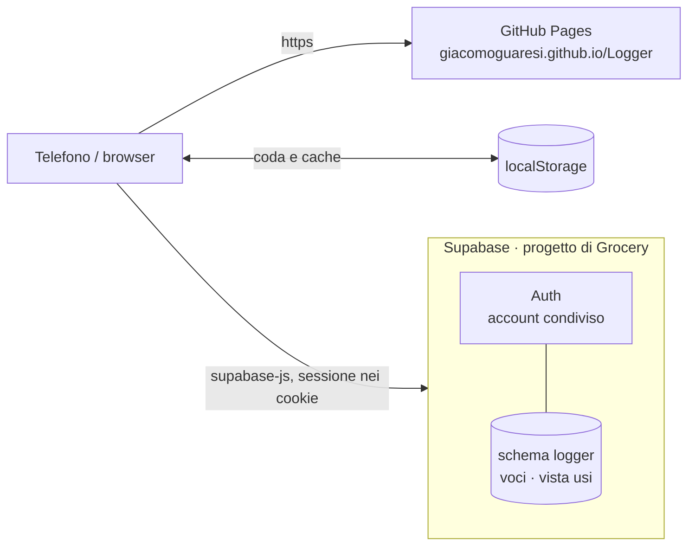

# 03 · Architettura

## Schema generale

Dalla Fase 2 Logger è un sito statico su **GitHub Pages** che parla direttamente con **Supabase**, come Grocery, Projects e Adventures. Niente server da tenere acceso.



> La prova in locale (Fase 1) girava sul Mac con SQLite dentro Vite: a ottobre 2026 è stata tolta, e in produzione si è partiti da un database vuoto ([07](07-decisioni.md)).

## Come funziona

1. **Accesso**: finché non c'è una sessione si vede solo la passphrase (`src/ui/ConAccesso.tsx`). La sessione sta nei cookie con percorso `/`, condivisa con le altre app di casa ([04](04-sicurezza.md)).
2. **Dati**: una tabella `logger.voci` e una vista `logger.usi` ([08](08-modello-dati.md)), lette e scritte dal browser con la chiave publishable; le policy vogliono la sessione.
3. Le **scelte** di soggetti e chiavi e l'**ultimo valore** vengono dal riepilogo `logger.usi`, non dalle righe lette per il diario: così ci sono anche i soggetti e le chiavi usati di rado. Il raggruppamento senza maiuscole e accenti si fa nel browser (`src/dominio/suggerimenti.ts`); il riepilogo si tiene in memoria per quando manca la rete, e le righe in coda ci si aggiungono subito.

## Archivio sostituibile

Il resto dell'app conosce solo l'interfaccia **`Archivio`** (`src/dati/archivio.ts`), come lo `Storage` di Grocery:

```ts
interface Archivio {
  leggi(opzioni: { soggetti?: string[]; prima?: string; limite: number }): Promise<Voce[]>
  usi(): Promise<Uso[]>              // riepilogo per soggetto · chiave
  salva(voce: Voce): Promise<void>   // upsert per id
  elimina(id: string): Promise<void>
}
```

| Implementazione | Dove gira | Quando |
|---|---|---|
| `ArchivioSupabase` | browser, parla con Supabase | nell'app |
| `ArchivioInMemoria` | test | nei test del sincronizzatore |

I **test di contratto** (`src/dati/contratto.ts`, `verificaContratto(apriVuoto)`) descrivono cosa ci si aspetta da qualunque archivio. Girano sempre su `ArchivioInMemoria`, e su `ArchivioSupabase` quando ci sono le variabili `SUPABASE_TEST_*` di un Supabase locale (`supabase start` con gli script di `supabase/sql/`): mai contro la produzione, perché ogni test svuota la tabella.

`ArchivioSupabase` distingue due errori, che decidono cosa fa la coda:
- **rifiutato** (`ErroreRifiutato`): codici SQLSTATE di classe 22 o 23, cioè dati che il database non accetta; riprovare non serve, la scrittura si toglie e si segnala;
- **rete** (`ErroreRete`): tutto il resto, compresa la sessione scaduta; la scrittura resta in coda e riparte dopo.

## Senza rete

Lo schema è quello di Grocery (`memoriaLocale.ts` e `sincronizzatore.ts`), più semplice:

- **Memoria locale** in `localStorage`, dietro un'interfaccia `Scaffale` (nei test una `Map`):
  - `logger.diari`: le ultime righe lette di ogni diario, per aprirlo subito;
  - `logger.usi`: il riepilogo per le card dei diari e le scelte di Registra;
  - `logger.coda`: le scritture non ancora arrivate all'archivio, dalla più vecchia.
- Ogni **riga ha l'`id` generato dal browser** (`crypto.randomUUID()`) e la sua data: una scrittura in coda è un `salva` o un `elimina` per `id`, quindi **rimandarla due volte non fa danni**, e la data resta quella vera anche se arriva dopo.
- Una **modifica** (dal diario, o Annulla dopo un'eliminazione) è un `salva` con lo stesso id e il segno `modifica`: non conta come riga nuova, e dopo l'invio il riepilogo si rilegge.
- Il **sincronizzatore** (`src/dati/sincronizzatore.ts`) svuota la coda in ordine quando l'app si apre, torna la rete (`online`), l'app torna in primo piano, si salva una riga o, con righe in attesa, ogni 30 secondi. Si ferma al primo errore di rete e riprova dopo; una scrittura rifiutata si toglie dalla coda e si segnala, per non bloccare le altre.
- Il service worker della PWA mette in cache solo la **shell** dell'app; Supabase va sempre in rete.

## Stack

| Livello | Scelta | Note |
|---|---|---|
| Linguaggio | TypeScript | |
| UI | React 19 | |
| Build | Vite, `base: '/Logger/'` | `npm run dev` con `--host`, per provarla dal telefono |
| Database e accesso | Supabase (`@supabase/supabase-js`, `@supabase/ssr`) | progetto di produzione di Grocery, schema `logger` |
| Routing | hash router | GitHub Pages non vede mai le rotte |
| Stile | Tailwind CSS, come Projects e Adventures | palette in [09](09-interfaccia.md) |
| Icone | lucide-react | |
| Memoria locale | localStorage | cache e coda, come Grocery |
| PWA | vite-plugin-pwa | |
| Test | Vitest, sulla logica pura e sul contratto dell'archivio | |
| Pubblicazione | GitHub Actions → GitHub Pages | `.github/workflows/pubblica.yml`, come Adventures |

## Test

Come nelle altre app, i test coprono la **logica pura**:
- pulizia e validazione di soggetto, chiave e valore; data scelta a mano mai nel futuro;
- contratto dell'archivio: salva e rilegge, upsert per id, ordine dal più recente, pagina con `prima` e `limite`, filtro per soggetti, riepilogo `usi`, eliminazione anche di una riga che non c'è;
- su Supabase (facoltativi): stesso contratto, check del database come errore "rifiutato", niente righe né riepilogo senza sessione, passphrase giusta e sbagliata;
- scelte: soggetti e chiavi per soggetto, confronto senza maiuscole e accenti, ordine per uso, forma più usata, filtro della ricerca, ultimo valore della coppia, chiavi con il loro conto;
- valori numerici e unità ("27" → "27€");
- date: campo `datetime-local` in andata e ritorno, "Oggi/Ieri/02/10", giornate della timeline nel fuso di chi guarda, date delle card;
- coda e sincronizzatore: invio in ordine, stop al primo errore di rete, scarto delle scritture rifiutate, modifica e Annulla con e senza rete, memoria locale vecchia o rovinata.

## Struttura cartelle

```
Logger/
├── README.md · Q&A.md · LICENSE · .env.example
├── .github/workflows/     # pubblica.yml: test, build e deploy su GitHub Pages
├── docs/
├── index.html · vite.config.ts · package.json · tsconfig.json
├── supabase/sql/          # 001_schema, 002_voci, 003_usi: applicati a mano
├── scripts/               # genera-sfondo.ts
├── public/                # icone PWA
└── src/
    ├── main.tsx
    ├── dominio/           # logica pura + test
    ├── dati/              # Archivio, ArchivioSupabase, accesso, contratto, memoria locale, sincronizzatore
    └── ui/                # guscio, accesso, Registra, Diario
```

## Convivenza con le altre app

Logger sta nel **progetto Supabase di produzione di Grocery**, come Projects e Adventures:

- **schema Postgres dedicato `logger`**, aggiunto agli *Exposed schemas* dell'API; il client si crea con `db: { schema: 'logger' }`;
- **autenticazione condivisa**: stesso utente Auth delle altre app, sessione nei cookie con percorso `/`;
- **migrazioni** in `supabase/sql/NNN_descrizione.sql`, numerate e applicate a mano dalla cartella di Grocery; lo storico della CLI resta a Grocery.
