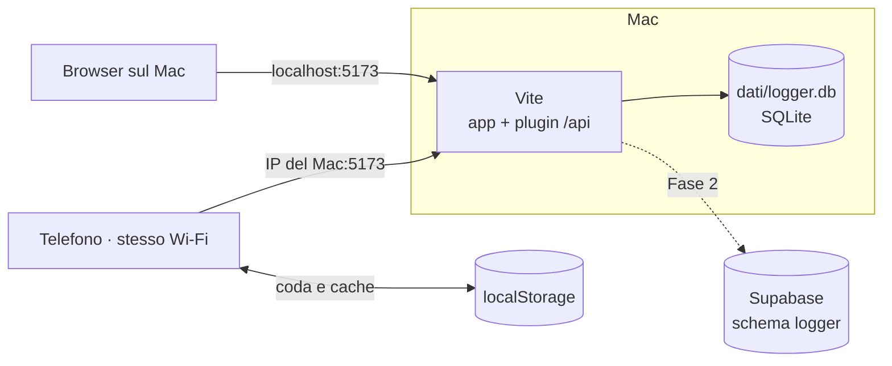

# 03 · Architettura

## Schema generale

Oggi, nella prova in locale:



## Come funziona

1. **Un solo processo**: Vite serve l'app e, con un plugin (`server/pluginApi.ts`), anche le rotte `/api`. Il plugin si aggancia sia al server di sviluppo (`configureServer`) sia a `vite preview` (`configurePreviewServer`).
   - `npm run dev` → `vite --host`: l'app si apre dal Mac e, all'IP del Mac, dal telefono;
   - `npm run prova` → build + `vite preview --host`, per l'uso di tutti i giorni.
2. Il database è **SQLite**, con il modulo **`node:sqlite`** incluso in Node 24: nessuna dipendenza nativa da compilare. Il file è `dati/logger.db`, escluso da git; la tabella si crea all'avvio se manca ([08](08-modello-dati.md)).
3. L'**API** è minima, in JSON:

   | Rotta | Cosa fa |
   |---|---|
   | `GET /api/voci?prima=<quando>&limite=100` | il diario, dalla riga più recente; `prima` serve a "Mostra altre" |
   | `PUT /api/voci/:id` | salva una riga; se l'`id` esiste già la sovrascrive (upsert), così rimandarla non crea doppioni |
   | `DELETE /api/voci/:id` | elimina una riga; eliminarne una che non c'è non è un errore |

   I dati arrivano dal browser e si controllano anche sul server, con la stessa pulizia del dominio (`src/dominio/`).
4. I **suggerimenti** di soggetti e chiavi si calcolano nel browser dalle righe già lette: con qualche centinaio di righe all'anno non serve altro.

## Archivio sostituibile

Il resto dell'app conosce solo l'interfaccia **`Archivio`**, come lo `Storage` di Grocery (`Grocery/src/storage/tipi.ts`):

```ts
interface Archivio {
  leggi(opzioni: { prima?: string; limite: number }): Promise<Voce[]>
  salva(voce: Voce): Promise<void>   // upsert per id
  elimina(id: string): Promise<void>
}
```

| Implementazione | Dove gira | Quando |
|---|---|---|
| `ArchivioSqlite` | server (plugin di Vite) | oggi |
| `ArchivioHttp` | browser, parla con `/api` | oggi |
| `ArchivioSupabase` | browser, parla con Supabase | Fase 2 |

I **test di contratto** (`src/dati/contratto.ts`, `verificaContratto(apriVuoto)`, come `Grocery/src/storage/contratto.ts`) descrivono cosa ci si aspetta da qualunque archivio. Oggi girano su `ArchivioSqlite` con un database `:memory:`; nella Fase 2 gli stessi test devono passare su `ArchivioSupabase`. Così il passaggio cambia una riga nel punto d'ingresso dei dati, non l'app.

## Senza rete

Arriva allo step 4 ([06](06-roadmap.md)). Serve quando il telefono perde il Wi‑Fi di casa con l'app aperta, e servirà ancora di più con Supabase. Lo schema è quello di Grocery (`Grocery/src/storage/memoriaLocale.ts` e `sincronizzatore.ts`), più semplice:

- **Memoria locale** in `localStorage`, dietro un'interfaccia `Scaffale` (nei test una `Map`):
  - `logger.voci`: le ultime righe lette, per aprire il diario subito;
  - `logger.coda`: le scritture non ancora arrivate all'archivio, dalla più vecchia;
  - `logger.soggetto`: l'ultimo soggetto usato.
- Ogni **riga ha l'`id` generato dal browser** (`crypto.randomUUID()`) e la data del momento in cui si scrive: una scrittura in coda è un `salva` o un `elimina` per `id`, quindi **rimandarla due volte non fa danni**, e la data resta quella vera anche se arriva dopo.
- Il **sincronizzatore** svuota la coda in ordine quando l'app si apre, torna la rete (`online`), l'app torna in primo piano o si salva una riga. Si ferma al primo errore di rete e riprova dopo; una scrittura **rifiutata** (dati non validi) si toglie dalla coda e si segnala, per non bloccare le altre.
- Il service worker della PWA mette in cache solo la **shell** dell'app (step 5, serve HTTPS: [05](05-esecuzione.md#https-per-la-pwa)).

## Stack

| Livello | Scelta | Note |
|---|---|---|
| Linguaggio | TypeScript | anche il server, eseguito da Vite |
| UI | React 19 | |
| Build e server | Vite, `--host` | il plugin `/api` vive dentro Vite |
| Database | SQLite con `node:sqlite` | Node 24; Supabase nella Fase 2 |
| Routing | hash router | come le altre app, pronto per GitHub Pages |
| Stile | Tailwind CSS, come Projects e Trekking | palette in [09](09-interfaccia.md) |
| Icone | lucide-react | |
| Memoria locale | localStorage | cache e coda, come Grocery |
| PWA | vite-plugin-pwa | step 5, con HTTPS locale |
| Test | Vitest, sulla logica pura e sul contratto dell'archivio | |
| Versioni | git **solo locale**, nessun repository remoto né pipeline | |

## Test

Come nelle altre app, i test coprono la **logica pura**:
- pulizia e validazione di soggetto, chiave e valore;
- contratto dell'archivio: salva e rilegge, upsert per id, ordine dal più recente, pagina con `prima` e `limite`, eliminazione anche di una riga che non c'è;
- rotte dell'API: risposte e codici per richieste valide e non valide;
- suggerimenti: soggetti e chiavi per soggetto, confronto senza maiuscole, ordine per uso, forma più usata;
- raggruppamento del diario per giorno ("Oggi", "Ieri", data);
- dallo step 4: coda (aggiunta, invio in ordine, stop al primo errore di rete, scarto delle scritture rifiutate) e lettura della memoria locale con dati vecchi o rovinati.

## Struttura cartelle

```
Logger/
├── README.md · Q&A.md · LICENSE
├── docs/
├── index.html · vite.config.ts · package.json · tsconfig.json
├── server/                # pluginApi.ts, rotte.ts, archivioSqlite.ts (+ test)
├── dati/                  # logger.db, escluso da git
├── public/                # icone PWA (step 5)
└── src/
    ├── main.tsx
    ├── dominio/           # logica pura + test
    ├── dati/              # Archivio, ArchivioHttp, contratto.ts, memoria locale
    └── ui/                # guscio, Registra, Diario
```

Lo scaffold si copia da Trekking, senza le parti di Supabase, mappa e Markdown.

## Dopo la prova: convivenza con le altre app

Nella Fase 2 Logger passa al **progetto Supabase di produzione di Grocery**, come Projects e Trekking:

- **schema Postgres dedicato `logger`**, aggiunto agli *Exposed schemas* dell'API; il client si crea con `db: { schema: 'logger' }`;
- **autenticazione condivisa**: stesso utente Auth delle altre app, sessione nei cookie con percorso `/`;
- **migrazioni** in `supabase/sql/NNN_descrizione.sql`, numerate e applicate a mano; lo storico della CLI resta a Grocery;
- le righe di `logger.db` si copiano con uno script, mantenendo `id` e `quando` ([08](08-modello-dati.md#passaggio-a-supabase)).
